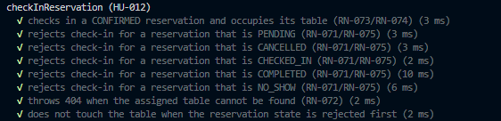
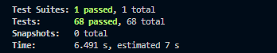

# HU 12: Registrar el check-in de una reserva

**Épica:** Gestión de Reservas · **Sprint:** 2 · **Prioridad:** Muy Alta · **Story Points:** 8
**Dependencias:** HU-007 (Registro de Reserva), HU-011 (Confirmación de Reserva)

> Como personal autorizado del restaurante, quiero registrar la llegada de un cliente con reserva, para confirmar su asistencia y habilitar la mesa asignada para iniciar la atención.

## Resumen

Se agregó el endpoint `PATCH /api/v1/reservations/{id}/check-in`, que cambia el estado de una reserva de `CONFIRMED` a `CHECKED_IN`, registra el momento exacto de la llegada en `checkedInAt`, y **además** cambia el estado de la mesa asignada a `OCCUPIED`. A diferencia de las HU 10 y 11, esta operación modifica **dos entidades** (reserva y mesa), por lo que corre dentro de una transacción de base de datos.

## Endpoint

| | |
|---|---|
| **Método y ruta** | `PATCH /api/v1/reservations/{id}/check-in` |
| **Parámetro de ruta** | `id`: UUID de la reserva |
| **Cuerpo** | Ninguno |
| **Respuesta exitosa** | `200 OK` con la reserva actualizada (`status: CHECKED_IN`, `checkedInAt` con la fecha y hora) |

### Respuestas posibles

| Código | Cuándo ocurre | Excepción | Dónde se origina |
|---|---|---|---|
| **200** | La reserva estaba en `CONFIRMED` y su mesa existe | ninguna | `ReservationsService.checkInReservation` |
| **400** | El `id` no tiene formato de UUID | (la lanza el pipe) | `ParseUUIDPipe` en el controller |
| **404** | No existe una reserva con ese `id` (RN-070) | `EntityNotFoundError` de TypeORM → traducido a 404 por `EntityNotFoundFilter` | `manager.findOneByOrFail`, dentro de la transacción |
| **404** | La reserva existe pero su mesa asignada no se encuentra (RN-072) | `NotFoundException` | `ReservationsService.checkInReservation` |
| **409** | La reserva no está en `CONFIRMED` (RN-071, RN-075) | `ConflictException` | `ReservationsService.checkInReservation` |

## Comportamiento según el estado actual

| Estado de la reserva | Resultado |
|---|---|
| `CONFIRMED` | Check-in exitoso (200); mesa pasa a `OCCUPIED` |
| `PENDING` | 409 |
| `CANCELLED` | 409 |
| `CHECKED_IN` | 409 |
| `COMPLETED` | 409 |
| `NO_SHOW` | 409 |

## Cambios por archivo

### `entities/reservation.entity.ts`
- Nuevo campo `checkedInAt`: columna normal (`timestamptz`, acepta nulos, tipo `Date | null`). Es `null` mientras la reserva no pasa por check-in.

### `reservations.service.ts`
- Nuevo método `checkInReservation(id)`, que corre dentro de `this.reservationRepository.manager.transaction(...)`:
  1. Lee la reserva con `manager.findOneByOrFail(Reservation, { id })`. Si no existe, TypeORM lanza `EntityNotFoundError` (traducido a 404 por el filtro global, ver abajo).
  2. Si el estado no es `CONFIRMED` (es decir, es `PENDING`, `CANCELLED`, `CHECKED_IN`, `COMPLETED` o `NO_SHOW`), lanza `ConflictException`.
  3. Lee la mesa asignada con `manager.findOne(TableEntity, { where: { id: reservation.tableId } })`. Si no existe, lanza `NotFoundException` (RN-072).
  4. Asigna `reservation.status = CHECKED_IN`, `reservation.checkedInAt = new Date()`, y `table.status = 'OCCUPIED'`.
  5. Guarda ambas entidades con `manager.save(...)`, cada una con su clase como primer argumento.
  6. Si cualquier paso falla, la transacción hace rollback: ni la reserva ni la mesa quedan modificadas.

### `reservations.controller.ts`
- Nuevo handler `PATCH :id/check-in`, con `ParseUUIDPipe` para validar el `id`, sin cuerpo, y con la documentación de Swagger de las respuestas (200, 400, 404, 409).

### `common/filters/entity-not-found.filter.ts` (nuevo)
- Filtro global (`@Catch(EntityNotFoundError)`) que traduce cualquier `EntityNotFoundError` de TypeORM (lanzado por `findOneOrFail`/`findOneByOrFail` en cualquier parte del proyecto) a una respuesta 404 estándar. Se registra en `main.ts` con `app.useGlobalFilters(new EntityNotFoundFilter())`.

## Por qué esta HU usa una transacción

A diferencia de cancelar o confirmar (que solo escriben la reserva), el check-in debe modificar **la reserva y la mesa a la vez**: si solo una se guardara, quedaría una reserva `CHECKED_IN` con su mesa libre, o una mesa `OCCUPIED` sin ninguna reserva real en curso. La transacción asegura que las dos escrituras pasen juntas o ninguna pase.

## Reglas de negocio cubiertas

| Regla | Descripción | Cómo se cumple |
|---|---|---|
| RN-070 | La reserva debe existir | `EntityNotFoundError` → 404 (vía filtro global) |
| RN-071 | Solo se permite el check-in desde `CONFIRMED` | Cualquier otro estado lanza `ConflictException` (409) |
| RN-072 | La reserva debe tener una mesa asignada válida | `NotFoundException` (404) si la mesa no se encuentra |
| RN-073 | La mesa cambia automáticamente a `OCCUPIED` | Se asigna y se guarda dentro de la misma transacción |
| RN-074 | Se guarda fecha y hora exactas del check-in | Campo `checkedInAt` |
| RN-075 | Rechazar `CANCELLED`, `NO_SHOW`, `CHECKED_IN`, `COMPLETED` y `PENDING` | `ConflictException` (409) |

## Base de datos

- Nueva columna `checkedInAt` en la tabla `reservations`.
- El proyecto no usa migraciones, por lo que no se agregó ninguna.

## Fuera de alcance

- **Guard de autorización por rol**: la HU lo pide, pero el proyecto todavía no tiene un módulo de usuarios ni de roles (confirmado con el equipo). Queda pendiente hasta que exista esa pieza.

## Comprobación de pruebas

Se agregó una sección de tests unitarios para `checkInReservation` en `reservations.service.spec.ts` (`describe('checkInReservation (HU-012)', ...)`), que cubre:

- Check-in exitoso desde `CONFIRMED`: verifica que todo corra dentro de una única transacción, que la mesa se busque por `tableId`, que **ambas** entidades se guarden (cada una con su clase) y que `checkedInAt` quede asignado.
- Rechazo (409) desde `PENDING`, `CANCELLED`, `CHECKED_IN`, `COMPLETED` y `NO_SHOW`, verificando que no se llame a `save`.
- 404 cuando la mesa asignada no se encuentra, verificando que tampoco se guarde nada.
- Que la mesa no se busca en absoluto si el estado ya fue rechazado (el corte ocurre antes).

Para correrlos:

```bash
npm run test -- reservations.service.spec
```

**Captura del resultado:**
 


### Prueba adicional manual: el rollback

Antes de dar por cerrada esta HU, se recomienda una prueba manual (no cubierta por los mocks, porque estos no usan una base de datos real): agregar temporalmente un `throw new Error('prueba')` entre el `save` de la mesa y el de la reserva, hacer check-in de una reserva `CONFIRMED`, y verificar en la base de datos que **ninguna de las dos** haya cambiado. Luego quitar el `throw`.

| # | Caso | Esperado | Resultado |
|---|---|---|---|
| 1 | Check-in de una reserva `CONFIRMED` | 200, `CHECKED_IN`, `checkedInAt` con fecha, mesa `OCCUPIED` | ⬜ pendiente |
| 2 | Check-in de `PENDING`, `CANCELLED`, `CHECKED_IN`, `COMPLETED` o `NO_SHOW` | 409 | ⬜ pendiente |
| 3 | UUID válido que no existe | 404 (vía filtro global) | ⬜ pendiente |
| 4 | Id que no es UUID (`abc`) | 400 | ⬜ pendiente |
| 5 | Revisar en la base de datos | Reserva `CHECKED_IN` con `checkedInAt`, mesa `OCCUPIED` | ⬜ pendiente |
| 6 | Prueba de rollback forzado (ver arriba) | Ni la reserva ni la mesa cambian | ⬜ pendiente |
| 7 | Swagger | El endpoint aparece con sus respuestas documentadas | ⬜ pendiente |

## Observaciones para el equipo

- `PATCH /reservations/{id}/status` permite pasar una reserva a `CHECKED_IN` sin tocar la mesa ni `checkedInAt`, y sin transacción. Conviene decidir si esa ruta delega en `checkInReservation` o deja de aceptar ese destino.
- La disponibilidad (`table-availability.service.ts`) solo ofrece mesas con estado `AVAILABLE`, sin mirar la fecha. Mientras una mesa esté `OCCUPIED`, no se podrá reservar para ningún horario, ni siquiera uno futuro, hasta que otra HU (probablemente la de `COMPLETED`) la devuelva a `AVAILABLE`.
- Falta decidir qué pasa si la mesa asignada ya está `OCCUPIED` (por ejemplo, un cliente sin reserva) o `OUT_OF_SERVICE` al momento del check-in; la HU no lo especifica.
- El Guard de autorización queda pendiente de que exista un módulo de usuarios y roles en el proyecto.