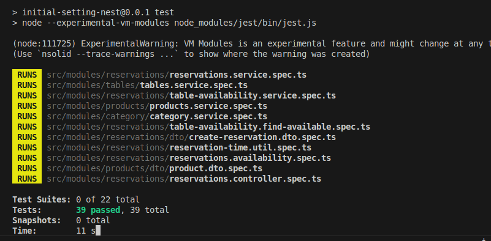

Documentación de Correcciones y Mejoras - Módulo de Mesas (Tables)

Este documento detalla las correcciones técnicas, el refactorio y los ajustes de esquema implementados en el módulo de Mesas de la API.

1. Soporte de Identificadores UUID y Corrección de Validación

Problema: Los endpoints que manejaban parámetros de ruta (:id) estaban configurados con ParseIntPipe, lo que generaba un error de validación 400 Bad Request (Validation failed (numeric string is expected)) debido a que el sistema utiliza UUIDs como llaves primarias.

Solución:

Se reemplazó ParseIntPipe por ParseUUIDPipe en los métodos del controlador findOne, update y updateStatus.

Se actualizaron los decoradores @ApiParam en TablesController especificando correctamente type: String junto con un ejemplo de UUIDv4 válido (ej., "31d85014-5c67-426c-8352-1766204cbf0c").

2. Mejora en la Documentación de Swagger y Ejemplos de Carga

Problema: La interfaz de Swagger carecía de ejemplos claros en el cuerpo de las peticiones (Request body) y no exponía correctamente los parámetros de filtrado por consulta (Query parameters).

Solution (Solución):

Se integraron los decoradores @ApiProperty y @ApiPropertyOptional dentro de CreateTableDto y FilterTablesDto, incorporando campos example explícitos para pre-llenar datos de prueba en la interfaz gráfica.

Se documentaron por completo las respuestas de estado HTTP (@ApiCreatedResponse, @ApiOkResponse, @ApiBadRequestResponse, @ApiNotFoundResponse, @ApiConflictResponse) para todas las operaciones del controlador.

Se limpiaron importaciones erróneas de consola (import { table } from 'console') que afectaban el tipado limpio del código.

3. Resolución de Conflictos en Migraciones de Base de Datos

Problema: Al ejecutar las migraciones de base de datos (npm run migration:run), se producía un error 42P07 (relation "tables" already exists), originado porque la estructura de la tabla ya existía físicamente en el esquema sin estar registrada en la tabla interna de historial de migraciones de TypeORM.

Solución:

Se concilió el estado de la base de datos alineando los archivos de migración y asegurando flujos de ejecución seguros para esquemas de tablas existentes.

Pruebas unitarias

pruebas e2e

